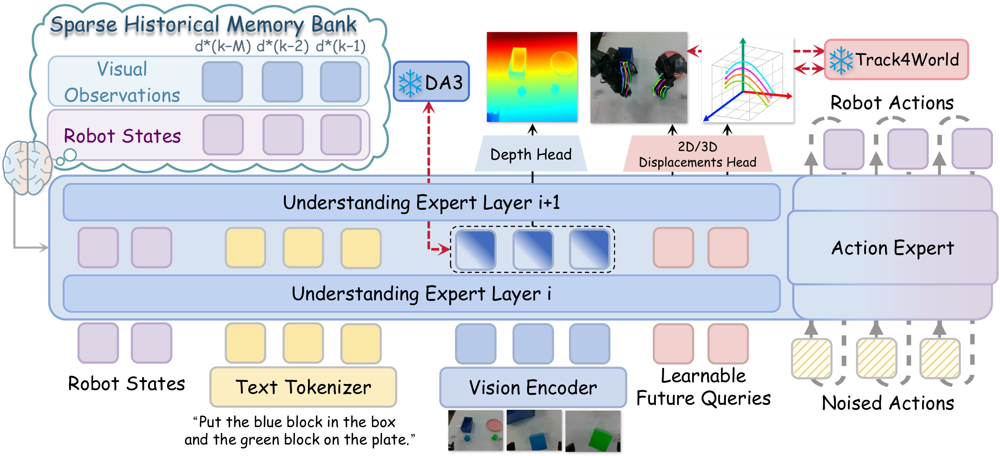

# Flow2Act: Learning to Act through Geometrically Grounded Motion Anticipation

[Lijun Guo](https://shawnricardo.github.io/)1,&#42;,
[Haoyu Zhao](https://maxwell-zhao.github.io/)2,&#42;,
Xianda Guo1, Chengwei Wu3, Yetong Zeng4,
Chenglong Zhang5, Qian Zhou1, Zhongyu Li2,
Hua Zou1,†

1 Wuhan University 
2 The Chinese University of Hong Kong 
3 NIO 
4 University of Hong Kong 
5 Nanjing University

&#42; Equal contribution · † Corresponding author

[Project page](https://shawnricardo.github.io/Flow2Act.github.io/)

## Architecture

